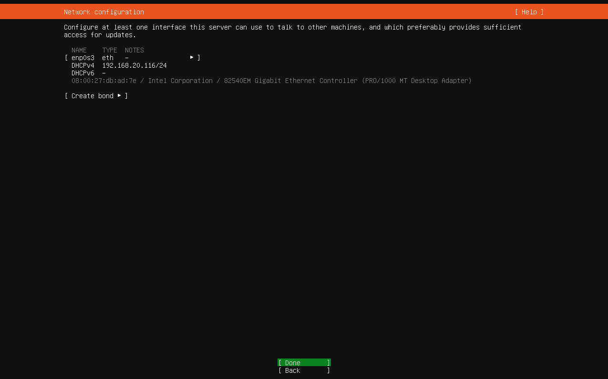
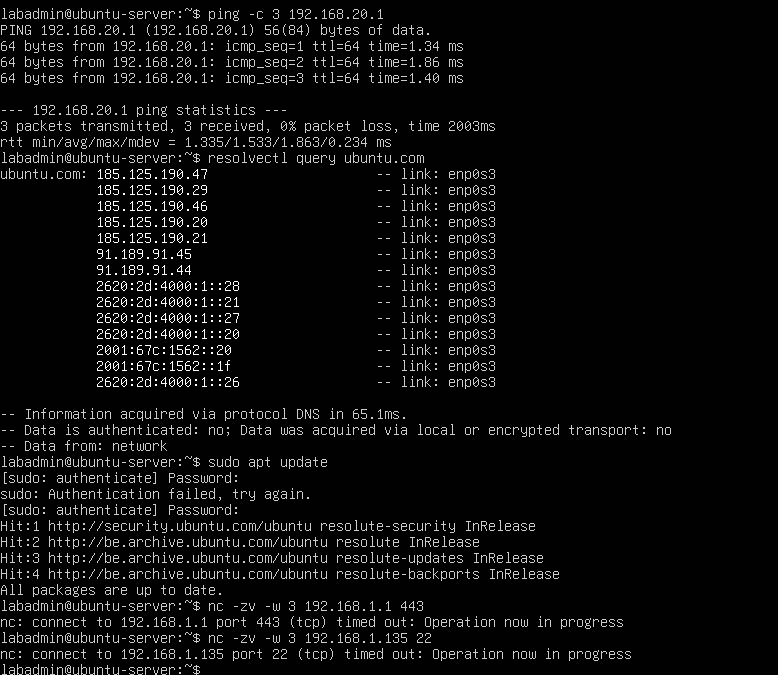
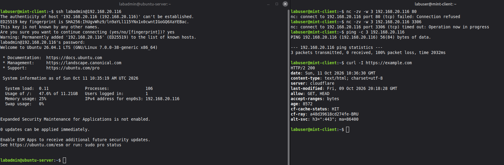
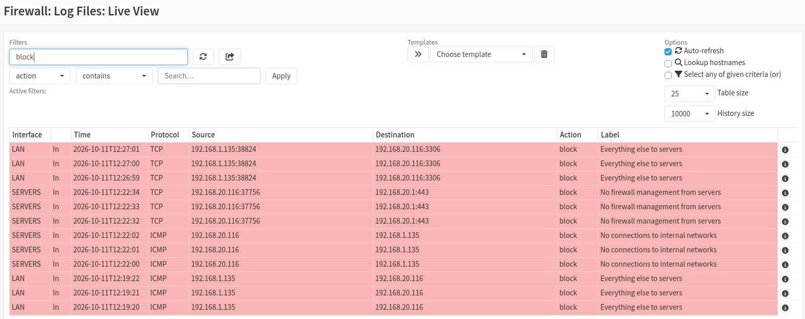

# Home Lab: OPNsense Firewall and Network Segmentation

A virtual network lab built in VirtualBox to practise firewalling,
VLANs and network security. Built while studying for CompTIA Network+.

## Lab 1: OPNsense firewall (done)

- **Platform:** VirtualBox on Windows
- **VM:** OPNsense 26.7, 2 vCPU, 2-4 GB RAM, 20 GB disk
- **Design:** WAN on NAT (internet side), LAN on an internal
  network (`lan1`)
- **Result:** LAN 192.168.1.1/24, WAN 10.0.2.15/24, internet
  reachable (ping to 8.8.8.8 works)

### What I learned
- Why OPNsense needs two interfaces (WAN and LAN)
- How internal networks isolate VMs in VirtualBox
- Why snapshots help before changing a firewall

## Lab 2: Client VM and web interface (done)

- **Client:** Linux Mint in VirtualBox on the internal network `lan1`
- **Result:** the client receives 192.168.1.x from the OPNsense
  DHCP server, reaches the firewall at 192.168.1.1, and reaches the
  internet only through OPNsense
- **Setup wizard:** hostname `opnsense-lab`, domain `home.lab`,
  DNS 1.1.1.1 and 9.9.9.9, timezone Europe/Brussels

### What I learned
- How a DHCP server on the LAN side hands out addresses
- Why the WAN needs "Block private networks" off in a NAT lab
- How to test connectivity step by step (client, firewall, internet)

## Lab 3: Network segmentation and firewall rules (done)

Two networks behind OPNsense, with least-privilege rules between them.

- **USERS:** `lan1`, 192.168.1.0/24 (Linux Mint client)
- **SERVERS:** `servers`, 192.168.20.0/24 (Ubuntu Server LTS,
  192.168.20.116 by DHCP)

### Policy

| From | To | Allowed |
|---|---|---|
| SERVERS | LAN / private networks | Nothing |
| SERVERS | Firewall | DNS and ping to the gateway only |
| SERVERS | Internet | Yes |
| LAN | SERVERS | SSH (22), HTTP (80), HTTPS (443) only |
| LAN | Internet | Yes |

Aliases: `SRV_MGMT_PORTS` (22, 80, 443) and `PRIVATE_NETS`
(10/8, 172.16/12, 192.168/16). Return traffic is allowed by the
stateful firewall.

### Test results

| Test | Result |
|---|---|
| Mint to server, SSH | Login works |
| Mint to server, port 80 | Refused (firewall passed it) |
| Mint to server, port 3306 | Timeout (blocked) |
| Mint ping to server | Fails (blocked) |
| Mint to internet | Works |
| Server to gateway, DNS, apt update | Works |
| Server to firewall web UI and to Mint | Timeout (blocked) |
| SSH session kept open under the block rule | Stays up (stateful) |
| DHCP renew on the server | Keeps its lease |

### Troubleshooting log
- **Interface stayed down:** a saved change is not active until you
  click Apply changes.
- **No DHCP on the new network:** the Dnsmasq log said "interface em2
  does not currently exist". The service had started before the
  interface was up, so a restart fixed it.
- **Installer could not download packages:** a new interface blocks
  everything by default. A temporary allow rule fixed it, and later
  I replaced it with the real rules.
- **Rule created as a floating rule:** I added it from the "All
  rules" view, so I recreated it on the SERVERS tab.
- **Alias entry rejected:** a pasted list kept leading spaces, so I
  entered each network on its own line.
- **Block rule had no effect:** it sat below "Default allow LAN to
  any". The first match wins, so rule order matters.

### Lessons learned
- Rule order decides everything, because the first match wins.
- A blocked packet gets no answer (timeout), while a closed port
  answers "refused". So "refused" means the firewall let it through.
- Logging the block rules makes testing easy: every test shows up in
  Live View with the rule name.
- New interfaces start with default deny, and changes only count
  after Apply.

## Roadmap
- [x] Lab 1: OPNsense firewall
- [x] Lab 2: client VM and web interface
- [x] Lab 3: segmentation and firewall rules
- [ ] Lab 4: 802.1Q VLANs
- [ ] Lab 5: VPN and monitoring
