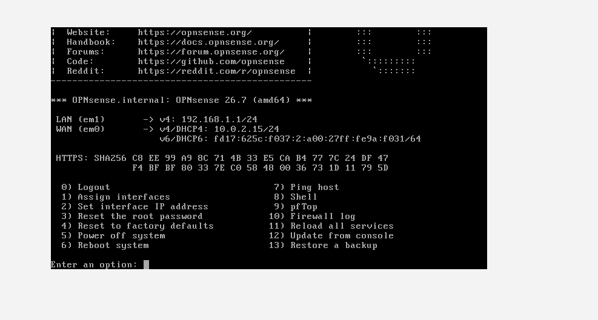
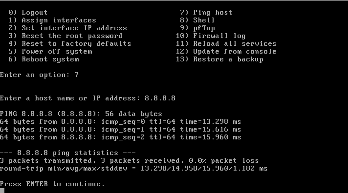
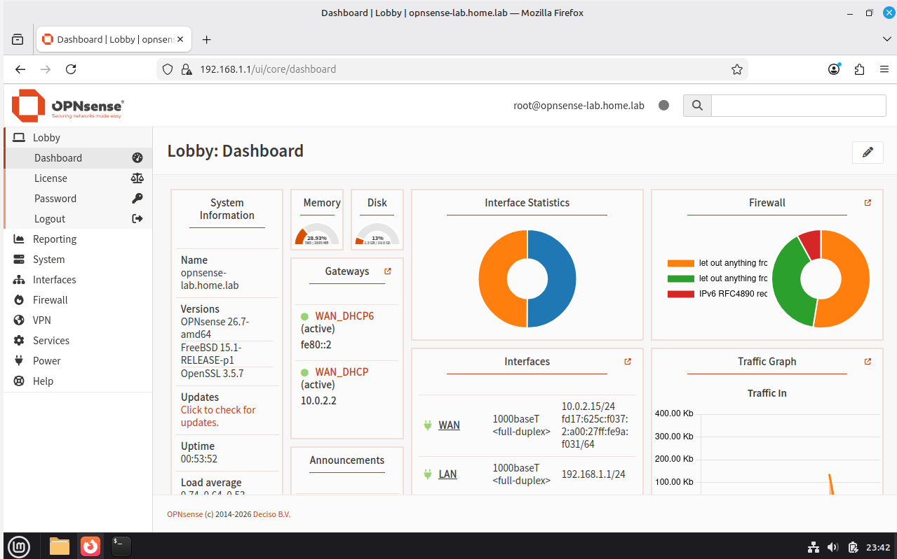
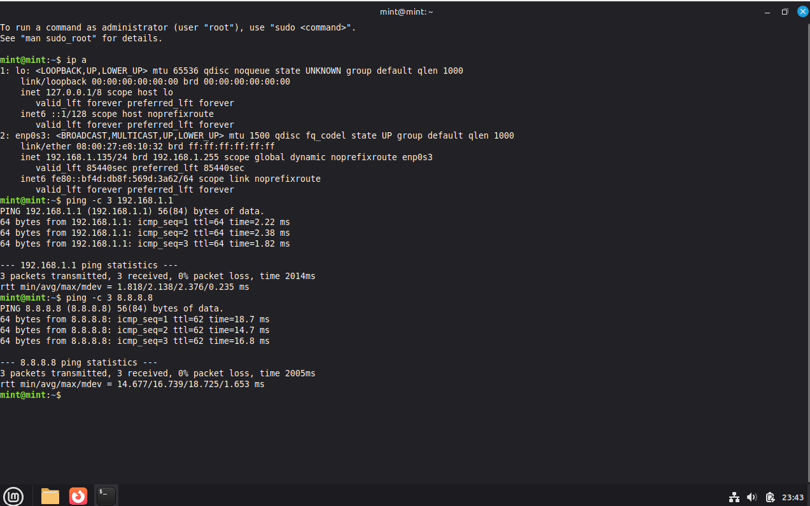

# Home Lab: OPNsense Firewall and Network Segmentation

A virtual network lab built in VirtualBox to practise firewalling,
VLANs and network security. Built while studying for CompTIA Network+.

## Lab 1: OPNsense firewall (done)

- **Platform:** VirtualBox on Windows
- **VM:** OPNsense 26.7, 2 vCPU, 2-4 GB RAM, 20 GB disk
- **Design:** WAN on NAT (internet side), LAN on an internal
  network (`lan1`)
- **Result:** LAN 192.168.1.1/24, WAN 10.0.2.15/24, internet
  reachable (ping to 8.8.8.8 works)

### What I learned
- Why OPNsense needs two interfaces (WAN and LAN)
- How internal networks isolate VMs in VirtualBox
- Why snapshots help before changing a firewall

## Lab 2: Client VM and web interface (done)

- **Client:** Linux Mint in VirtualBox on the internal network `lan1`
- **Result:** the client receives 192.168.1.x from the OPNsense
  DHCP server, reaches the firewall at 192.168.1.1, and reaches the
  internet only through OPNsense
- **Setup wizard:** hostname `opnsense-lab`, domain `home.lab`,
  DNS 1.1.1.1 and 9.9.9.9, timezone Europe/Brussels

### What I learned
- How a DHCP server on the LAN side hands out addresses
- Why the WAN needs "Block private networks" off in a NAT lab
- How to test connectivity step by step (client, firewall, internet)

## Roadmap
- [x] Lab 1: OPNsense firewall
- [x] Lab 2: client VM and web interface
- [ ] Lab 3: VLANs and firewall rules
- [ ] Lab 4: VPN and monitoring
